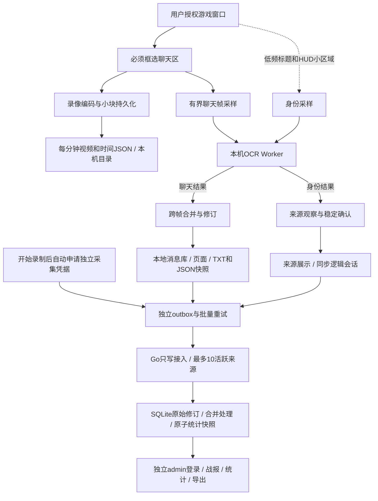

# 架构设计

更新日期：2026-11-27。本文描述模块、数据流和边界；目标与验收见 [SPC](spc/README.md)，选择理由见 [ADR](adr/README.md)，协作规则见 [AGENTS](../AGENTS.md)。目标架构不能当作已交付能力。

## 当前状态

- 第二阶段已有 Go 接收/处理、SQLite、独立同步队列和私有管理页；此前已执行部署，本轮未重新检查线上版本，不再沿用“服务器尚无Go/数据库”的过时描述。
- [SPC-0007](spc/0007-recording-priority.md)：录像分段与OCR取消隔离的本地修复已通过当轮自动检查，真实浏览器长录制仍待验证，未部署。
- [SPC-0008](spc/0008-automatic-collector-and-source.md)：公共自动接入、来源识别及10来源限额已本地实现。自动检查和独立Review通过，并实测浏览器合成窗口录制；真实游戏长录制/多DPI待验收，未部署。
- 后续完整用户管理、多区归属、战斗场次归档、多实例均不属于本轮。

## 同仓目录与模块

```text
AGENTS.md                 Agent开发、审查、测试和交付规则
README.md                 使用与开发入口
docs/
  architecture.md         模块与数据边界（本文）
  spc/                    一轮需求一份规格，关联验收证据
  adr/                    一项重要决策一份记录，保留演进
  tasks/                  历史实施与验证记录
  templates/              SPC/ADR模板
frontend/src/
  app/                    页面和用例编排，显示各支路独立状态
  capture/                窗口、选区、录制、身份采样与纯解析
  ocr/                    Worker、模型资源、图像预处理、推理RPC
  messages/               跨帧对齐、修订、消息合并
  storage/                录像/消息IndexedDB、文件保存与恢复
  sync/                   公共接入、独立outbox、epoch映射、批量重试
  admin/                  独立登录、原始战报、统计、名单与来源管理
backend/
  cmd/server/             Go进程入口、配置和生命周期
  internal/httpapi/       路由、权限、注册、准入限流、请求日志
  internal/processing/    解析、去重、姓名与阵营归一化、统计
  internal/store/         SQLite接收、修订、任务和原子结果发布
contracts/                本地数据与wire v2协议
config/examples/          非敏感名单模板
scripts/                  资源准备、构建和验证脚本
deploy/                   Nginx、服务部署与回滚说明
tests/phase1/             录像、OCR、存储、消息合并
tests/phase2/             网络、接入、权限与服务端集成
```

真实数据、凭据、模型、缓存、node_modules和dist不提交。服务器数据放独立data-dir，升级静态资源/可执行文件不覆盖数据库、名单和备份；目录见 [第二阶段设计](phase-2-design.md) 与 [部署指南](../deploy/phase2.md)。

## 数据流



虚线身份支路、自动申请及活跃名额对应SPC-0008本地实现；未上线，浏览器实测边界见验证记录。

## 录像优先与故障域

录像启动与分段保存不等待身份识别、模型、OCR、文本同步或服务器许可。OCR繁忙时跳过过时采样，不创建无界帧队列；录像成功必须以视频和元数据文件关闭提交为准。

编码器在旧段onstop后启动新段，文件写入独立完成，避免两个编码器重叠；接受短暂切换间隙。每段数据错误独立判定，后继失败不能阻止健康前段保存。未保存缓存保留恢复，不能把requestData后续块当独立WebM。见 [ADR-0009](adr/0009-recorder-resource-isolation.md)。

OCR使用Dedicated Worker，但仍共享GPU、CPU、主线程、磁盘和同源配额。停止OCR应终止在途推理；关闭OCR不改变录像会话token。文件、浏览器、系统休眠等故障不可能保证零中断。资源压力自动降频、文本最终保存卡住的独立收尾仍有遗留，不能宣称完全资源隔离。

来源识别与聊天OCR也需分清故障域：聊天优先，身份低频、失败保持未知。首轮阻塞问题已修复：先处理聊天，再运行有5秒时限的身份任务；身份超时独立退避并在下轮重建Worker，保留聊天OCR开启。

## 三种身份及时间

| 概念 | 用途 | 信任边界 |
| --- | --- | --- |
| 采集sourceId/token | 浏览器独立只写接入、限额、撤销 | 仅表示持有采集凭据，不证明某玩家 |
| 观测区服/线路/角色 | 页面展示及战场上下文 | OCR可能错，未知显示未知，不作为认证 |
| admin会话 | 查询、配置、名单、人工修订、导出 | 独立HttpOnly会话与CSRF，不能用采集token访问 |

当前单区使用，不要求用户补身份；无OCR仍可录像。未来多区和用户归属另建规格。身份只读取已授权窗口，额外小区域不扩大录像选区，不上传截图。

采集UTC时间与单调时钟锚点用于录像/观察；游戏聊天时间单独保存；服务端校时偏移和不确定性不是游戏事件精度。身份确认边界取连续确认帧的采样时间，不能取推理完成时间；消息首次入队后固定归属，修订不得重新跨epoch分配。

## 本地存储与同步契约

- 视频段与消息库沿用本地schema v1；sync使用独立IndexedDB，不因协议变化升级录像库。MessageArchive每会话写最新版TXT/JSON；两文件并非跨文件原子事务。
- MergedMessage保存稳定ID、revision、首次/末次采集时间、原文、来源帧和观察次数。相同文本不永久去重；相邻视口按顺序/时间/内容对齐。视频用于以后重处理，不存全部原始OCR观察。
- wire v2携带来源、同步会话、不可变context及消息修订；新增可选character字段需前后端一同升级，严格后端会拒绝未知字段，旧客户端可不发该字段。
- 身份变化建立同步epoch，录像session不变；captureSessionId与captureFromMs映射持久化。旧消息修订按首次观察归属，不因当前线路变更而重新贴标签。已经上传的unknown保持未知，本轮不自动回填。
- 同步库升级为v3，新增intents保存未接入时本次采集意图，assignments原子固定消息归属，旧v1队列与grants保留。已确认且过期会话清理时一并清理归属记录，不无限累积。
- 同步默认开启的新行为仅覆盖新会话；旧未授权历史不得自动上传。已有授权待传记录仍可补传。outbox有数量与载荷上限，每批最多50条，逐项验证确认，失败保留重试。

契约见 [contracts/types.ts](../contracts/types.ts)、[contracts/sync.ts](../contracts/sync.ts)，理由见 [ADR-0011](adr/0011-observed-source-and-sync-epochs.md)。

## 接入与负载控制（SPC-0008）

公共JSON注册生成每浏览器随机只写凭据，存储token哈希，复用且可撤销；同源检查不等于用户认证。没有公共共享密钥或管理员密钥写入前端。

默认10个最近两分钟活跃source；校时/上传请求续租，过期/撤销释放。第11个来源收到429，前端有界退避、本地继续记录；不承诺公平排队。另有注册每IP10/小时、全局100/小时、总量1000及上传IP/全局频率上限，减少无限注册绕过名额的资源风险。公开访客仍可能占满名额，保留运维关闭入口。参数和局限见 [ADR-0010](adr/0010-public-collector-admission.md)。

客户端注册/上传均有超时，网络请求不进入录像等待链。已有凭据401后不自动重新注册绕过撤销。Nginx必须覆盖而非透传不可信X-Real-IP，Go仅信任受控反代。管理页面不因隐藏链接而安全，所有admin API必须鉴权。

## 部署与验收

前端TypeScript/Vite静态资源与Go服务同仓、独立构建。Nginx提供HTTPS及API反代；模型固定公开ModelScope链接，约73MiB权重由公开源下载，本站提供约28MiB运行库与字典。不调用在线OCR、不上传截图或视频；新自动同步会产生文字注册/校时/批量请求，不能再描述成“页面打开后永远没有服务端流量”。

本轮验证见 [2026-11-27报告](tasks/2026-11-27-automatic-collector-validation.md)，未部署。发布应同时兼容前后端新增字段、公共接入开关与代理IP边界，先完成独立Review、集成回归与真实窗口验证，再记录提交和部署版本。代码完成、测试通过、推送、部署、用户验收分别记录，不能相互替代。
## 目录写入前置检查（SPC-0009）

选定目录立即用随机专用临时文件执行create/write/close，成功才接受目录；每次开始前复验，验证中禁开始，失败不创建编码器。清理仅删除自身测试文件，清理失败保留警告，不把可写误判不可写。失败保留目录名称、阶段和原错误类型，不限定盘符或中文路径。小文件成功不保证后续权限和空间永久有效，录像保存的错误和恢复继续独立处理。无新架构决策，沿用ADR-0002/0009。

2026-11-27用户随后授权发布本轮更新；线上版本须从 `/fighting/version.json` 和部署回执核验，不依据本文早前的本地状态快照推断。